<div align="center">

# 💰 HomeLedger

**Your money, on your own server.**
A free, open-source, self-hosted personal finance manager.

[](LICENSE)
[](CHANGELOG.md)
[](https://hub.docker.com/r/irving1flores/homeledger)
[](ha-integration/)
[](docs/USER_MANUAL.md#mcp-ai-assistants)

<a href="docs/screenshots/dashboard.jpg">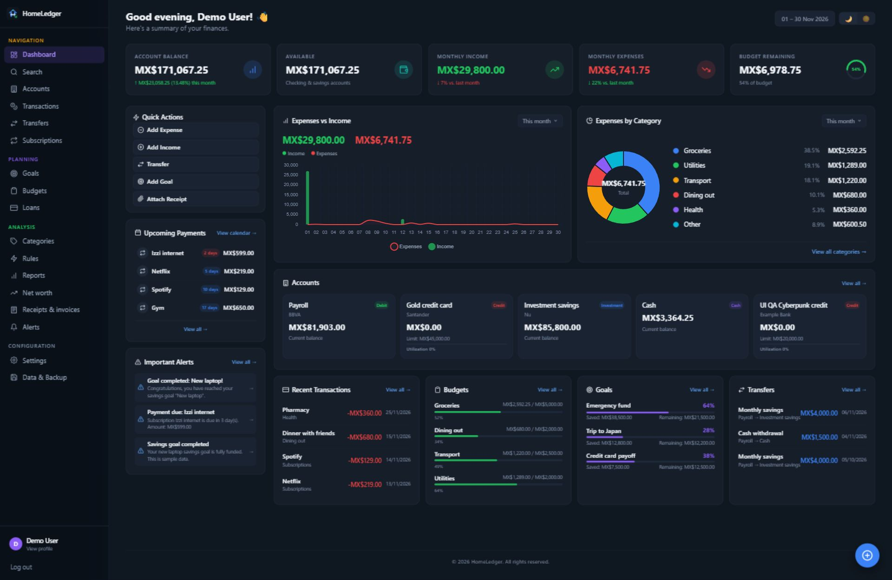</a>

[**Quick Start**](#quick-start) ·
[**Features**](#features) ·
[**Screenshots**](#screenshots) ·
[**User Manual**](docs/USER_MANUAL.md) ·
[**Docker**](#docker-recommended-for-production) ·
[**Home Assistant**](#home-assistant) ·
[**API**](#api-endpoints)

</div>

---

## ❤️ Support the Project

HomeLedger is built and maintained in spare time, and it will always be free.
If it helps you keep your finances in order, here are a few ways to give back:

<div align="center">

[](https://github.com/sponsors/TastingRogue)
[](https://buymeacoffee.com/TastingRogue)

</div>

| Can't donate? These help just as much | |
|---|---|
| ⭐ **Star the repo** | Helps other people find it |
| 🐛 **Report bugs** | [Open an issue](https://github.com/TastingRogue/HomeLedger/issues/new/choose) |
| 💡 **Suggest features** | [Start a discussion or request](https://github.com/TastingRogue/HomeLedger/issues/new/choose) |
| 🛠️ **Contribute** | See the [Contributing guide](CONTRIBUTING.md) |

---

## About

> **HomeLedger** is a free, open-source, self-hosted personal finance manager: an expense tracker and budgeting app you run on your own server. Track bank accounts, income and expenses, budgets, savings goals, subscriptions and net worth, with a Home Assistant add-on and one-command Docker deployment.

HomeLedger is a **self-hosted personal finance app** for people who want to own their financial data instead of trusting it to a cloud service. It is a privacy-friendly, open-source alternative to Mint, YNAB or Monarch. It runs anywhere Docker runs (home server, VPS, NAS, homelab or Raspberry Pi) and optionally integrates with **Home Assistant** as an add-on and HACS integration. Bilingual (English / Spanish) with a configurable install currency.

| | |
|---|---|
| **Using HomeLedger** | [User Manual](docs/USER_MANUAL.md) · [Environment Variables](#environment-variables) · [Upgrading](#upgrading) · [Account Recovery](#account-recovery-locked-out) |
| **Contributing** | [Development](#development) · [Contributing guide](CONTRIBUTING.md) · [Roadmap](ROADMAP.md) |

## Screenshots

These screenshots show the current application running in Docker with synthetic
English demo data. No real financial information is shown.

### Normal

The original dashboard supports light and dark mode, with balances, cash flow,
spending categories, upcoming payments and quick actions.


<details>
<summary>Original theme: focused workflow screenshots</summary>

#### Transactions

A compact table view with filters and month groups.

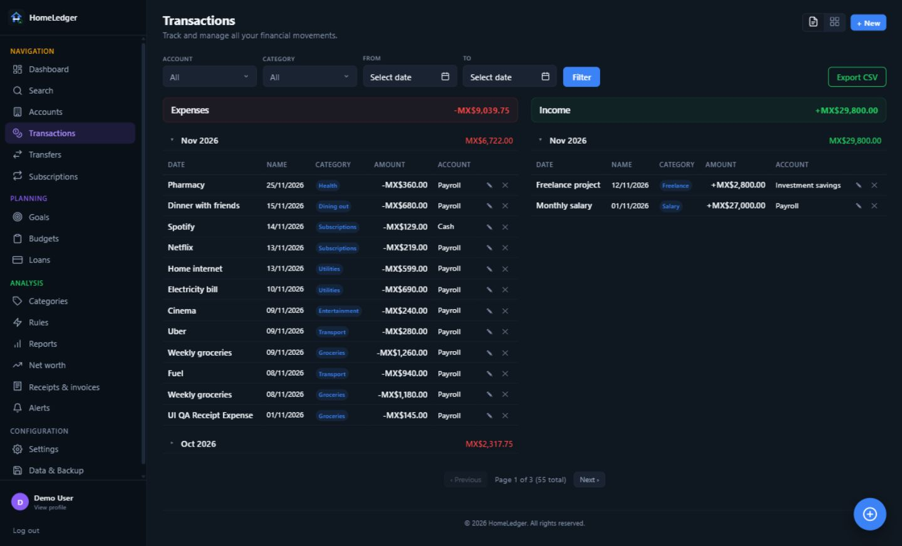

#### Budgets

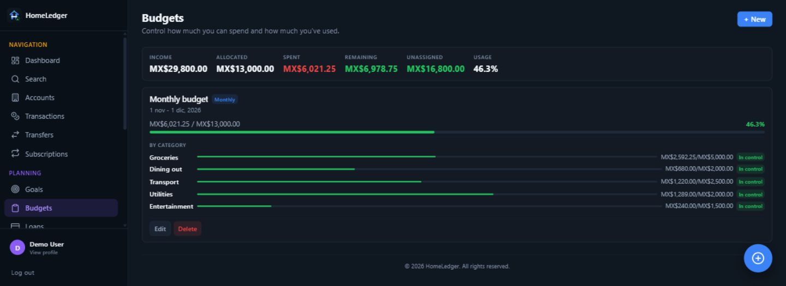

#### Savings goals

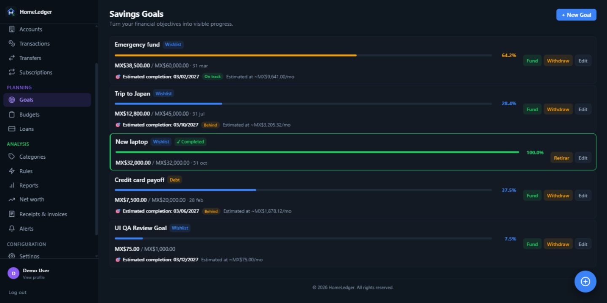

#### Subscriptions

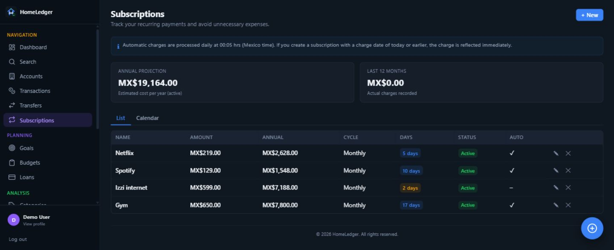

#### Transfers

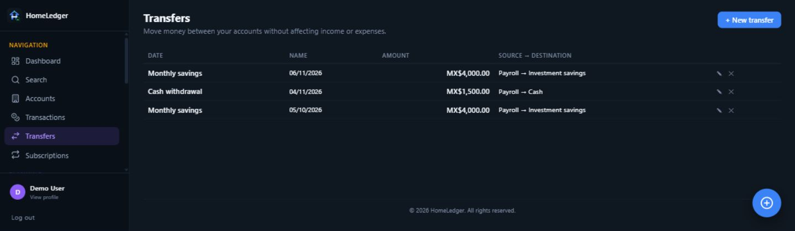

#### Categories

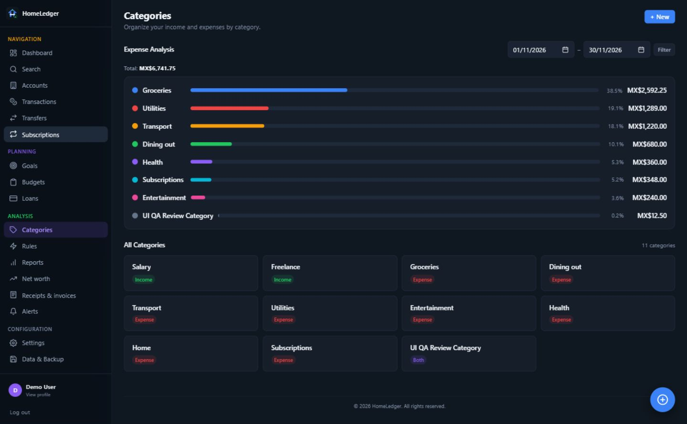

#### Receipts and invoices

Review the original document alongside extracted fields and OCR text.

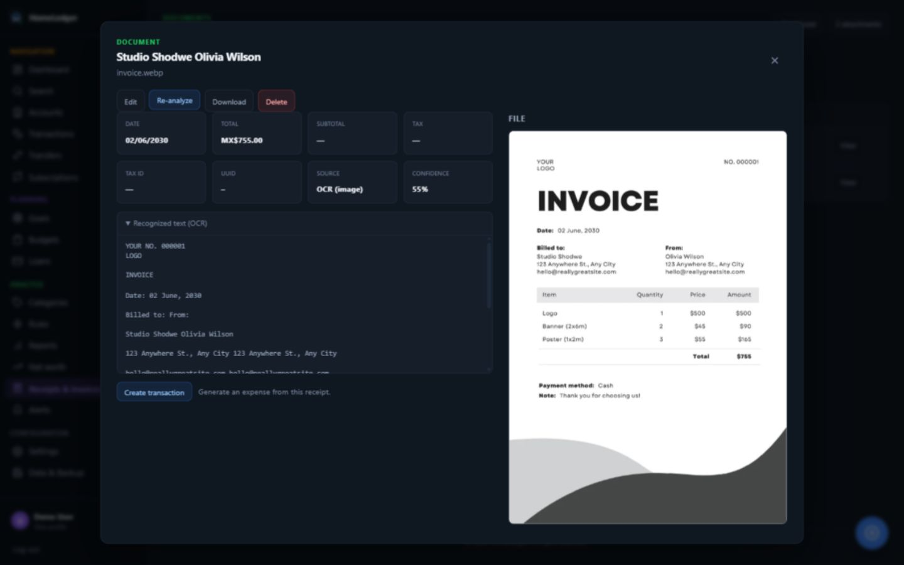

#### Data and backup

Export a portable copy of your financial data.

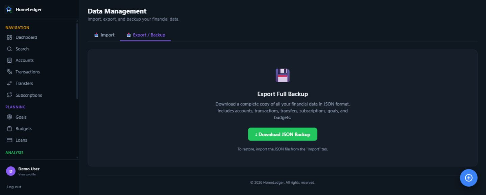

</details>

### Cyberpunk 2077

A burgundy and black interface with electric yellow headers, cyan income,
coral expenses and compact terminal panels. The theme covers the dashboard,
accounts, planning, reports, forms and authentication screens.

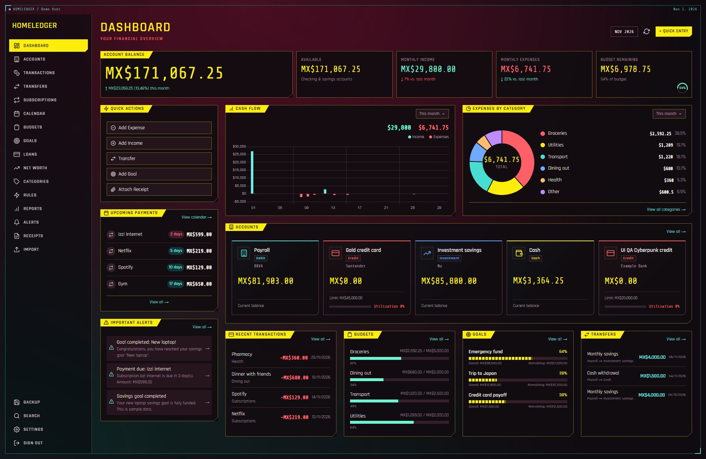

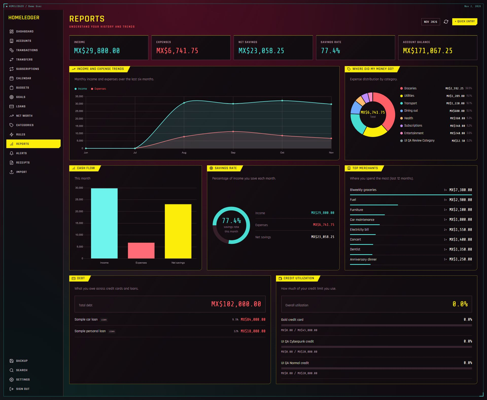

The mobile calendar uses a readable agenda with every event available. The
example below shows one complete day.


## Interface themes

Choose **Settings → Profile → Interface design → Normal / Cyberpunk 2077**.
The choice applies immediately and is saved in your browser. Cyberpunk has its
own dark palette; your Normal light/dark preference is preserved when switching.
Both designs use the same accounts, data and financial workflows.

Themes live in separate folders and are discovered through a typed registry.
See [Creating and contributing themes](docs/THEMES.md) to add a palette or an
optional page composition without changing the settings UI or database.
Cyberpunk 2077 is an unofficial visual inspiration; this project is not affiliated
with CD PROJEKT RED.

## Features

- **Interface themes**: Normal (light/dark) and modular Cyberpunk 2077, selected in Settings
- **Multi-account**: Debit, Credit, Investment, Vouchers, Cash — with dynamic balance tracking
- **Transactions**: Full income/expense recording with split by type, subcategories, per-transaction category splits, month grouping, card grid + table views, and **CSV export**
- **Transfers**: Movements between accounts with fund validation and edit support
- **Subscriptions**: Recurring payment management with auto-charge, catch-up after downtime, and visual calendar
- **Budgets**: Category and tag-based spending control with progress bars and dashboard integration
- **Savings Goals**: Objective tracking with fund/withdraw actions and progress visualization
- **Loans**: Track principal, interest and term with an amortization schedule, payment recording, and payoff progress
- **Credit Monitoring**: Utilization bars, health status, and linked subscriptions
- **Bank Import**: CSV/XLSX/OFX/QIF/JSON with parsers for BBVA, Santander, and Nu Mexico
- **Rules**: Auto-categorization engine — condition/action rules with test + apply-to-uncategorized
- **Categories**: Per-user — each user gets their own editable default set (in the instance language) at sign-up, with subcategories and type classification (Expense/Income/Both)
- **Alerts**: Auto-generated (low balance, high credit, due payments, completed goals) with manual evaluation trigger
- **Reports**: 6-month trends, category donut, savings rate ring, monthly comparison bars
- **Backup**: Full JSON export/import (with dry-run preview and validation) plus scheduled admin gzip whole-DB snapshots with in-app restore
- **Attachments**: Upload receipts/invoices (images, PDFs) and link to transactions/transfers
- **Dashboard**: Complete financial summary with editable items, combo charts, period dropdowns
- **Receipts**: Analyze uploaded receipts/attachments to extract transaction details
- **Admin**: User management, registration control (first-user/open/closed + allowlist), and instance settings — admin-gated
- **Currency**: base currency per install (MXN, USD, EUR, GBP, COP, ARS, CLP, PEN, BRL), with per-account currencies and manual exchange rates
- **Language**: Spanish + English with full interface translation
- **Responsive**: Scales to any screen resolution with dynamic font sizing
- **Home Assistant**: Addon + Custom Integration with sensors and services
- **API REST**: All endpoints under `/api/v1` with JWT + API key auth
- **MCP server (opt-in)**: Let AI assistants such as Claude Desktop read your finances and record transactions at `/api/v1/mcp`. Off by default; each user must confirm before enabling (see [User Manual](docs/USER_MANUAL.md#mcp-ai-assistants))

## Tech Stack

| Component | Technology |
|-----------|-----------|
| Frontend | SvelteKit 5 (SSR + SPA) |
| Backend API | Fastify 5 |
| Database | SQLite (better-sqlite3) + Drizzle ORM |
| Language | TypeScript (full-stack) |
| Validation | Zod |
| Auth | JWT + bcrypt + refresh tokens |
| Scheduler | node-cron (auto-charges, alerts, budget resets, backups) |
| Charts | Chart.js (dynamic import for SSR compat) |
| Testing | Vitest + fast-check |
| Packaging | Docker multi-arch |
| Icons | Custom SVG Icon component (Lucide-style) |

## Quick Start

The fastest way to run HomeLedger is Docker — no toolchain to install. For local
development from source (Node) see **[Development](#development)**.

### Docker (recommended for production)

**Option 1 — Prebuilt image from Docker Hub**

A multi-arch image is published to Docker Hub on every push to `main`. The
image is self-contained: a single process serves both the web app and the API
on port 3000, so it runs with no extra command.

```bash
docker pull irving1flores/homeledger:latest

docker run -d \
  -p 3000:3000 \
  -v homeledger-data:/data \
  -e JWT_SECRET="your-strong-random-secret-min-32-chars" \
  -e ADMIN_EMAIL="admin@homeledger.local" \
  -e ADMIN_PASSWORD="your-strong-password" \
  -e DEFAULT_LOCALE="en" \
  -e DISPLAY_CURRENCY="USD" \
  --name homeledger \
  irving1flores/homeledger:latest

# Then open http://localhost:3000 and log in with the email/password above.
```

**What each flag does** (only `JWT_SECRET` and `ADMIN_PASSWORD` are required — omit the rest to take the defaults):

| Flag | What it does | Your options |
|------|--------------|--------------|
| `-p 3000:3000` | Publishes the app + API on host port 3000. Without it the container runs but you can't reach it. | Any `HOST:3000` (e.g. `-p 8080:3000` to use `localhost:8080`) |
| `-v homeledger-data:/data` | Persists the SQLite DB + attachments in a named volume, so data survives rebuilds. | A named volume, or a host path (`-v /my/folder:/data`) |
| `-e JWT_SECRET=…` | **Required.** Random secret (≥32 chars) used to sign login tokens. | Any long random string |
| `-e ADMIN_EMAIL=…` | Email for the first admin user, created on first run. | Any email (default `admin@homeledger.local`) |
| `-e ADMIN_PASSWORD=…` | **Required.** Password for that admin. | A strong password |
| `-e DEFAULT_LOCALE=…` | Starting UI language + the language your default categories are seeded in. Each user can change their own later in **Settings**. | `en` or `es` (default `en`) |
| `-e DISPLAY_CURRENCY=…` | The base currency for consolidated totals. Accounts can use other currencies with manual exchange rates. | `MXN` `USD` `EUR` `GBP` `COP` `ARS` `CLP` `PEN` `BRL` (default `MXN`) |

> :bulb: The `\` at the end of each line is a **bash** line-continuation. On
> **Windows PowerShell**, use a backtick `` ` `` instead, or put the whole
> `docker run` on a single line.
>
> The first account created becomes the admin. `DEFAULT_LOCALE` / `DISPLAY_CURRENCY`
> are optional — see the full [Environment Variables](#environment-variables) table.

### Run from Docker Desktop (no command line)

The image requires a strong `JWT_SECRET` before it can start.

1. Open **Images** and click **Run** on `irving1flores/homeledger`.
2. Expand **Optional settings** and map host port `3000` to container port `3000`.
3. Mount a persistent folder or volume at `/data`.
4. Under **Environment variables**, set `JWT_SECRET` to a random value of at
   least 32 characters. Optionally set `ADMIN_EMAIL` and `ADMIN_PASSWORD` to
   create an administrator at startup.
5. Optionally set `DEFAULT_LOCALE` (`en` or `es`) and `DISPLAY_CURRENCY`.
6. Click **Run** and open <http://localhost:3000>. Without a bootstrapped admin,
   register the first account to become the administrator.

**Option 2 — Build from source with Docker Compose**

```bash
# Clone and configure
git clone https://github.com/TastingRogue/HomeLedger.git
cd HomeLedger
cp .env.example .env
# Edit .env: set JWT_SECRET + ADMIN_PASSWORD (required), and optionally
# DEFAULT_LOCALE (en|es) and DISPLAY_CURRENCY (MXN|USD|…). Compose reads .env,
# so this file — not -e flags — is where you configure this deployment.

# Start with Docker Compose (backend on 3000, frontend on 5173)
docker compose up -d
```

## Environment Variables

The Docker image has no built-in credentials. Supply `JWT_SECRET` at runtime;
production startup rejects missing or known insecure values.

| Variable | Description | Default (Docker image) |
|----------|-------------|------------------------|
| `JWT_SECRET` | Secret key for signing tokens (min 32 chars) | unset — **required** |
| `CORS_ORIGIN` | Comma-separated allowed origins; unset reflects the request origin | unset (reflect origin) |
| `ADMIN_EMAIL` | Admin user email | `admin@homeledger.local` |
| `ADMIN_PASSWORD` | Admin password | unset — optional admin bootstrap |
| `ALLOW_INSECURE_DEFAULTS` | Explicitly bypass startup security checks for disposable demos only. | `false` |
| `TRUST_PROXY` | Trust `X-Forwarded-*` from a reverse proxy so `request.ip` (rate limiting/logging) is the real client. Set to `true` when behind Nginx/Traefik/Caddy; leave unset for direct connections. | unset (disabled) |
| `DEFAULT_LOCALE` | Primary language for the install (the language each user's default categories are seeded in at sign-up, and the UI's default language before any user picks one): `es` or `en`. Users can still switch their own language and rename/delete their own categories. | `en` (falls back to English if unset/invalid) |
| `DISPLAY_CURRENCY` | Base currency for consolidated totals (`MXN`, `USD`, `EUR`, `GBP`, `COP`, `ARS`, `CLP`, `PEN`, `BRL`). Accounts have their own currency and manual exchange rate to base. | `MXN` |
| `LOG_LEVEL` | Server log verbosity (pino): `fatal`, `error`, `warn`, `info`, `debug`, `trace`, `silent` | `info` |
| `TZ` | Timezone | `America/Mexico_City` |
| `PORT` | Server port (app + API) | `3000` |
| `DATA_DIR` | Persistent data directory: SQLite database **and** uploaded attachments (`$DATA_DIR/attachments`) | `/data` (Docker) · `./data` (local) |
| `BACKUP_ENABLED` | Enable the scheduled backup job (gzip whole-DB snapshots under `$DATA_DIR/backups`) | `true` |
| `BACKUP_RETENTION` | How many snapshots to keep; older ones are rotated out | `7` |
| `BACKUP_CRON` | Cron schedule for automated backups (server timezone) | `0 3 * * *` (daily 03:00) |
| `REGISTRATION_MODE` | Who may register: `first_user_only` (safe default — first user bootstraps admin, then closed), `open`, or `closed`. Admin can change it in-app; env only seeds the initial value. | `first_user_only` |
| `REGISTRATION_ALLOWLIST` | Optional comma-separated email allowlist; when set and mode is `open`, only these emails may register | unset (no allowlist) |

> :floppy_disk: **Data persistence.** Everything under `DATA_DIR` — the database
> and receipt/invoice attachments — lives on the `homeledger-data` volume, so it
> survives `docker compose up --build --force-recreate` and container rebuilds.
> Deleting the volume (`docker compose down -v`) is what wipes your data.

## Account Recovery (locked out?)

If you forget the admin password, disable the only admin, or somehow end up with
no admin, use the built-in **admin recovery CLI**. It runs directly against the
database (no email needed) and works headless, so you can always regain access
**without wiping your data**.

```bash
# Docker (against a running container):
docker exec -it homeledger node dist/cli/admin.js list-users
docker exec -it homeledger node dist/cli/admin.js reset-password admin@homeledger.local
# ^ prints a new strong password once. Or pass your own:
docker exec -it homeledger node dist/cli/admin.js reset-password admin@homeledger.local 'MyNewPassw0rd'

# Local (from the repo root):
npm run admin -w packages/backend -- list-users
npm run admin -w packages/backend -- reset-password admin@homeledger.local
```

Commands: `list-users`, `reset-password <email> [password]`,
`create-admin <email> [password] [name]`, `promote <email>` (make a user admin),
`enable <email>` (re-enable a disabled account). If you omit the password, a
strong one is generated and printed once — copy it, then change it in-app.

> An admin who **can** log in can also reset another user's password from the
> app (admin user-management). The CLI is the fallback for when nobody can log in.
>
> :email: **Email-based reset (optional, not built in):** HomeLedger is
> local-first and ships no SMTP dependency, so there is no "email me a reset
> link" flow by default. The CLI above is the supported recovery path. An
> optional SMTP flow could be added later for setups that want it.

## Upgrading

Upgrades are designed to be safe: your data lives on the `homeledger-data`
volume (see above), and the app brings the database schema up to date
automatically on startup.

```bash
# Prebuilt image
docker pull irving1flores/homeledger:latest
docker stop homeledger && docker rm homeledger
docker run -d -p 3000:3000 -v homeledger-data:/data \
  -e JWT_SECRET="..." --name homeledger irving1flores/homeledger:latest

# Docker Compose (from source)
git pull
docker compose up -d --build --force-recreate
```

On boot the backend runs any pending Drizzle migrations and reconciles a couple
of columns that are managed idempotently (`attachments.transfer_id` /
`original_name` and their index). Running an old database against a newer image
is safe — schema changes are additive and applied automatically; no manual
migration step is required.

> :bulb: **Always keep a backup before upgrading.** Use **Settings → Data &
> Backup → Export** (or the `/api/v1/backup/export` endpoint) so you can restore
> if something goes wrong. Backup import remaps ids safely, so a restore never
> collides with existing data.

## Deployment & operations

For putting HomeLedger on the public internet safely, see
**[docs/DEPLOYMENT.md](docs/DEPLOYMENT.md)**:

- **Reverse proxy + HTTPS** — copy-pasteable configs for Caddy (automatic TLS),
  Nginx (+ certbot), and Traefik (Docker labels), plus the `TRUST_PROXY` /
  `CORS_ORIGIN` wiring for running behind a proxy.
- **Backup & restore / disaster recovery** — the three mechanisms (per-user JSON
  export/import with preview, automated whole-DB gzip snapshots + in-app restore,
  and volume-level tar), and which to use when.
- **Upgrading & rolling back**, and account recovery.

## API Endpoints

Base URL: `/api/v1` — Auth via `Authorization: Bearer <token>` or `X-API-Key: <key>`.

| Resource | Methods |
|----------|---------|
| `/auth` | register, login, refresh, logout, me (GET/PUT), change-password, revoke-all-sessions |
| `/users` *(admin)* | list, enable/disable, delete, reset-password, registration policy (GET/PUT), instance currency (GET/PUT) |
| `/accounts` | CRUD + deactivate |
| `/transactions` | CRUD + quick create + split + **CSV export** (`/export.csv`) |
| `/transfers` | CRUD (create, list, update, delete) |
| `/subscriptions` | CRUD + delete + calendar |
| `/goals` | CRUD + fund + withdraw |
| `/budgets` | CRUD + summary |
| `/loans` | CRUD + record payment + amortization schedule + payments |
| `/categories` | CRUD + subcategories + analysis |
| `/alerts` | list, mark read, mark all read, evaluate, delete, settings |
| `/reports` | dashboard, cashflow, trends, categories, budget-vs-actual |
| `/networth` | current, history, assets/liabilities CRUD |
| `/attachments` | upload, list, download, link, delete |
| `/receipts` | list, get, analyze attachment |
| `/imports` | upload, preview, confirm |
| `/backup` | export, import, preview (dry-run); snapshots list/create/restore *(admin)*; history |
| `/ha` | status, webhook, sensors |
| `/health` · `/config` | liveness probe (+ `/health/scheduler`, admin) · public runtime config |

> [!NOTE]
> As of **v1.0.0**, the `/api/v1` surface and the backup file format are
> **stable** under [Semantic Versioning](https://semver.org/): no breaking
> changes within `1.x`. See **[docs/STABILITY.md](docs/STABILITY.md)** for
> exactly what's covered, what counts as an additive (non-breaking) change, and
> what would require a `2.0.0`.

## Scheduler Jobs

| Job | Schedule | Description |
|-----|----------|-------------|
| Auto-charge | Daily 00:05 + on startup | Processes due subscriptions, catches up missed charges |
| Alert evaluation | Every hour + on startup | Evaluates all alert conditions for all users |
| Budget reset | Monthly (day 1, 00:10) | Resets budget periods |
| Backup snapshot | `BACKUP_CRON` (default daily 03:00) | Gzip whole-DB snapshot under `$DATA_DIR/backups` + retention rotation. Toggle with `BACKUP_ENABLED`. |

All four report into an in-memory status registry, visible to admins at
`GET /api/v1/health/scheduler`.

## Multi-currency & i18n

- **Currency:** an administrator chooses the base currency. Each account can use
  a supported currency and a manually maintained exchange rate to base.
  Consolidated totals convert account amounts using those rates; amounts on
  individual accounts remain in their native currency. Cross-currency transfers
  require a destination amount. Rates are not fetched automatically and default
  to 1 when omitted, so set them explicitly for foreign-currency accounts.
- **Language:** Spanish / English, switchable per user in Settings.
- **Timezone:** America/Mexico_City by default, configurable in the environment.

## Home Assistant

HomeLedger ships with two independent Home Assistant pieces. You can use either
or both:

- **Add-on** (`ha-addon/`) — runs the whole HomeLedger app *inside* Home
  Assistant, with the web UI embedded in the HA sidebar via Ingress.
- **Custom integration** (`ha-integration/`, HACS) — connects to a running
  HomeLedger instance and exposes your finances as HA **sensors, binary
  sensors and services** for dashboards and automations.

### Option A — Add-on (run the app inside Home Assistant)

Requires Home Assistant OS or Supervised (the Supervisor must be available).

1. **Add the add-on repository**
   - Go to **Settings → Add-ons → Add-on Store**.
   - Open the **⋮** menu (top-right) → **Repositories**.
   - Add the repository URL:
     ```
     https://github.com/TastingRogue/HomeLedger
     ```
   - Click **Add**, then close the dialog.
2. **Install** — find **HomeLedger** in the store and click **Install** (the
   image is multi-arch: `amd64` and `aarch64`/arm64, so it runs on x86 servers
   and 64-bit Raspberry Pi).
3. **Configure** — open the add-on's **Configuration** tab and set at least:

   | Option | Required | Notes |
   |--------|----------|-------|
   | `JWT_SECRET` | **Yes** | Min 32 chars; use a strong random value |
   | `ADMIN_PASSWORD` | **Yes** | Password for the initial admin user |
   | `ADMIN_EMAIL` | No | Defaults to `admin@homeledger.local` |
   | `TZ` | No | Defaults to `America/Mexico_City` |

4. **Start** — go to the **Info** tab and click **Start**. Enable **Show in
   sidebar** for one-click access.
5. **Open** — launch it from the HA sidebar (Ingress), or directly at
   `http://<HA_IP>:3000`, and log in with the admin credentials you set.

Data is stored under `/data` (SQLite DB + attachments) and is included in Home
Assistant backups.

### Option B — Custom integration via HACS (finance sensors in HA)

Use this to pull HomeLedger data into HA. It works with **any** running
HomeLedger instance — the add-on above, a Docker deployment, etc. It polls
locally every 5 minutes (no cloud).

**Prerequisites:** a running HomeLedger instance reachable from HA, and an
**API key** generated in HomeLedger (sent with the `X-API-Key` header).

1. **Add the repository to HACS**
   - In HACS, open the **⋮** menu → **Custom repositories**.
   - Repository: `https://github.com/TastingRogue/HomeLedger`
   - Category: **Integration** → **Add**.
2. **Install** the *HomeLedger* integration from HACS, then **restart Home
   Assistant**.
3. **Add the integration** — go to **Settings → Devices & Services → Add
   Integration**, search for **HomeLedger**, and fill in:
   - **API URL** — e.g. `http://<HA_IP>:3000` (add-on) or your instance URL.
   - **API key** — the key generated in HomeLedger.
   - **Name** *(optional)* — a friendly label.

   The setup validates the connection against `/api/v1/ha/status`, so a wrong
   URL or key is reported immediately.

**Entities created:**

- **Sensors:** monthly expenses, monthly income, monthly savings, remaining
  budget, net worth, total balance, credit card utilization.
- **Binary sensors:** over budget, high credit utilization, payment due soon,
  low balance.

**Services** (callable from automations/scripts):

| Service | Purpose |
|---------|---------|
| `homeledger.create_transaction` | Create an income/expense (name, amount, type, account_id, category_id) |
| `homeledger.create_quick_expense` | Quick expense (amount, account_id, category_id) |
| `homeledger.refresh_data` | Force a data refresh |

Example: notify when a subscription payment is due soon, or when credit
utilization is high, using the binary sensors as automation triggers.

## Development

Prefer to run from source (Node) instead of Docker? You'll need **Node.js ≥ 20**
(Docker images build on Node 22) and **npm ≥ 9**.

```bash
git clone https://github.com/TastingRogue/HomeLedger.git
cd HomeLedger
npm install
cp .env.example .env          # edit it — JWT_SECRET is required (min 32 chars)

npm run dev:backend           # API on http://localhost:3000
npm run dev:frontend          # Frontend on http://localhost:5173 (proxies /api to 3000)
```

The first user you register becomes the admin; the SQLite database is created
automatically on first run. See **[CONTRIBUTING.md](CONTRIBUTING.md)** for the
full contributor guide (conventions, testing, migrations, and a two-step guide
to **adding a language**).

### Scripts

```bash
npm run dev:backend       # Backend with hot-reload (tsx watch)
npm run dev:frontend      # Frontend with Vite HMR
npm run build             # Build shared + backend + frontend
npm run test              # Run all tests (Vitest, backend + frontend)
npm run lint              # Lint all packages
npm run format            # Format with Prettier
npm run db:generate -w packages/backend   # Generate a migration
npm run db:migrate  -w packages/backend   # Apply migrations
```

Before opening a PR, make sure these pass from the repo root:

```bash
npm run typecheck -w packages/backend    # tsc --noEmit
npm run typecheck -w packages/frontend   # svelte-check (expect 0 errors, 0 warnings)
npm run test                             # full monorepo suite
npm run build                            # full build
```

### Applying code changes (Docker rebuild)

> :warning: **The Docker images bake the source at build time — they do not
> mount your working copy.** After changing backend or frontend code you **must
> rebuild the image**, or the container keeps running the old code. (Compose only
> mounts `/data`, never the source.)

```bash
# Docker Compose (dev): rebuild + recreate with the new code.
# --force-recreate replaces the running containers; the homeledger-data volume
# (your DB) is preserved. No need to stop/remove anything first.
docker compose up -d --build --force-recreate
docker compose ps            # confirm both containers are healthy

# Standalone image:
docker build -t homeledger:standalone .
docker rm -f homeledger
docker run -d --name homeledger -p 3000:3000 -v homeledger-data:/data homeledger:standalone
```

**Publishing to Docker Hub:** commit to `main` and push — the GitHub Actions
workflow (`.github/workflows/docker-build.yml`) rebuilds and pushes automatically.

**Notes for specific changes:**

- **Receipt OCR:** results are cached in the DB. After changing the parser,
  existing receipts keep their old values until you press **Re-analyze** in the
  receipt popup (or restore a backup).
- **New tables created outside Drizzle** (raw SQL, like `receipt_analyses`): also
  clear them in `BackupService.import()` so a restore wipes them like the rest.
- **New env vars:** add a sensible default in the `Dockerfile` (for zero-config
  run) and document them in the [Environment Variables](#environment-variables) table.

### Project structure

```
homeledger/
├── packages/
│   ├── backend/          # Fastify API — routes/v1, services, db (schema/
│   │   │                 #   migrations), middleware, scheduler, importers
│   │   └── data/         # SQLite DB + attachments (DATA_DIR)
│   ├── frontend/         # SvelteKit 5 — routes, lib/api, lib/stores,
│   │   │                 #   lib/components, lib/i18n (es/en), app.css
│   │   └── ...
│   └── shared/           # Shared TypeScript types
├── ha-addon/             # Home Assistant Add-on
├── ha-integration/       # HA Custom Integration (Python)
├── docs/                 # USER_MANUAL.md, DEPLOYMENT.md, STABILITY.md, screenshots
├── Dockerfile            # Single self-contained image (app + API)
├── docker-compose.yml    # Deployment config
└── .env.example          # Environment template
```

## Contributing

Contributions are welcome! See **[CONTRIBUTING.md](CONTRIBUTING.md)** for local
setup, the checks to run before a PR, project conventions, and a two-step guide
to **adding a language**. Bug reports and feature requests use the issue
templates.

By participating, you agree to abide by our
**[Code of Conduct](.github/CODE_OF_CONDUCT.md)**. To report a security
vulnerability, please follow our **[Security Policy](.github/SECURITY.md)**.

## License

MIT
