# Screenshots

[← HomeLedger](../README.md)

These screenshots show the current application running in Docker with synthetic
English demo data. No real financial information is shown.

## Normal

The original dashboard supports light and dark mode, with balances, cash flow,
spending categories, upcoming payments and quick actions.

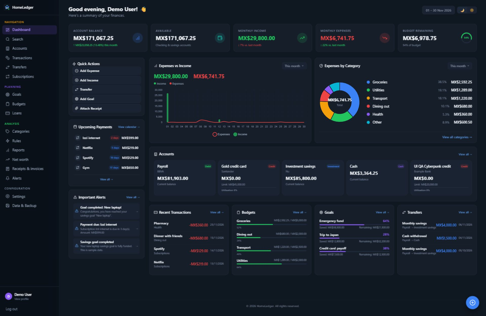

Original theme: focused workflow screenshots

### Transactions

A compact table view with filters and month groups.

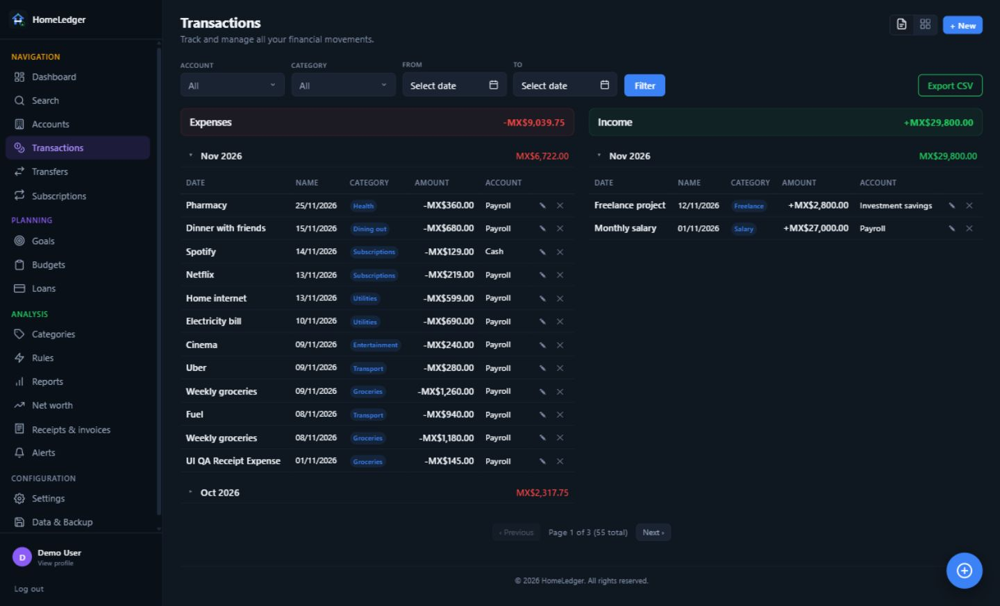

### Budgets

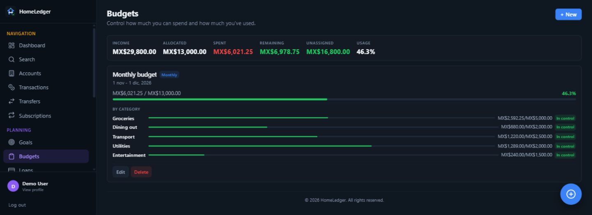

### Savings goals

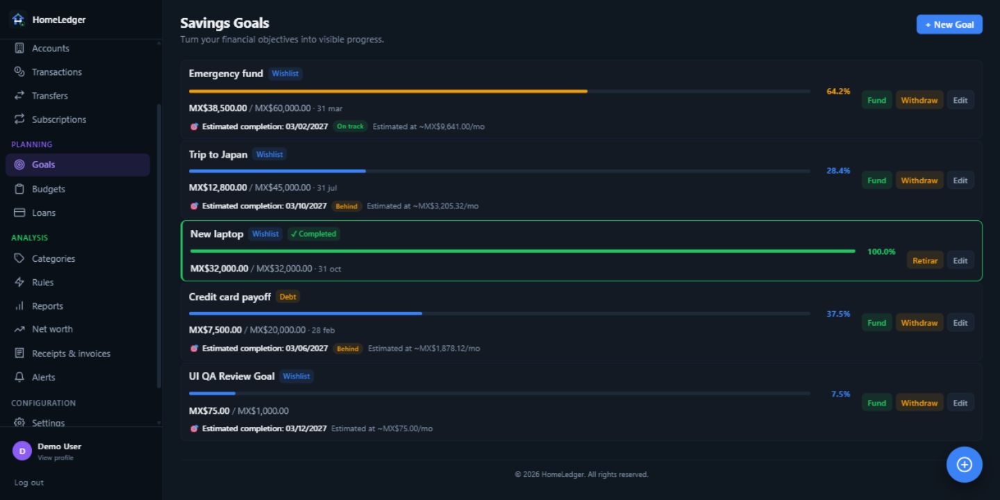

### Subscriptions

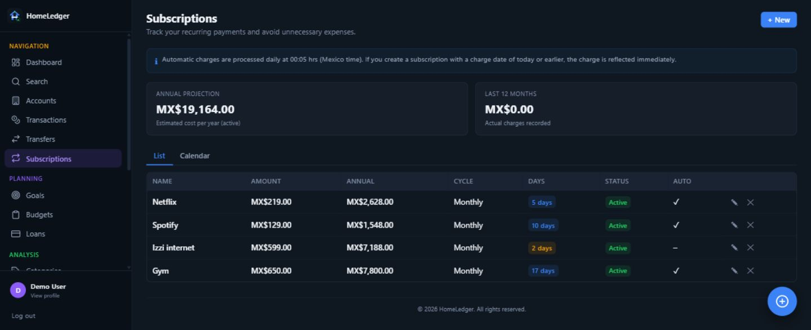

### Transfers

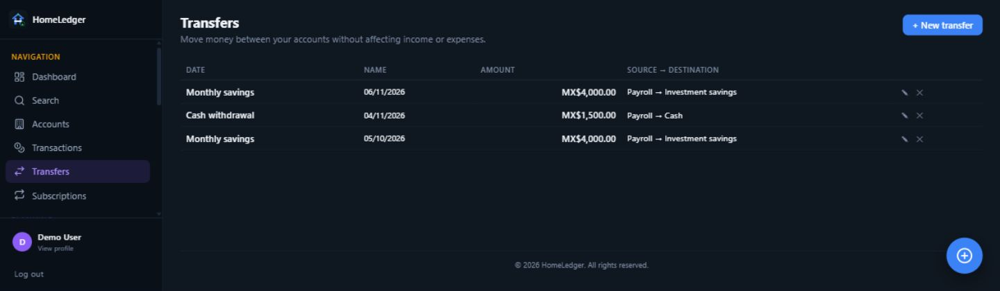

### Categories

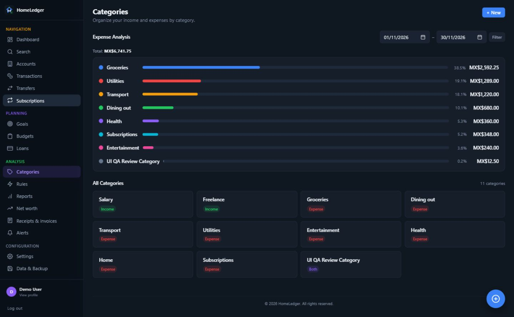

### Receipts and invoices

Review the original document alongside extracted fields and OCR text.

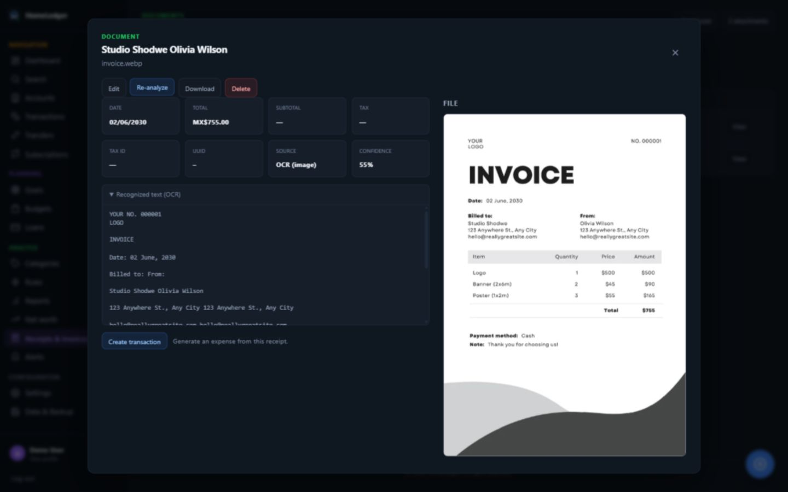

### Data and backup

Export a portable copy of your financial data.

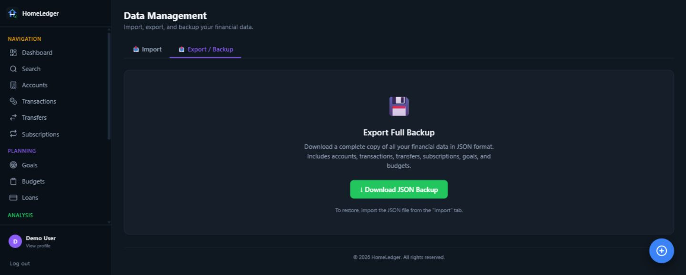

## Cyberpunk 2077

A burgundy and black interface with electric yellow headers, cyan income,
coral expenses and compact terminal panels. The theme covers the dashboard,
accounts, planning, reports, forms and authentication screens.

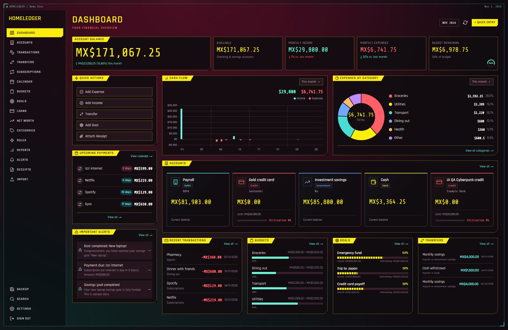

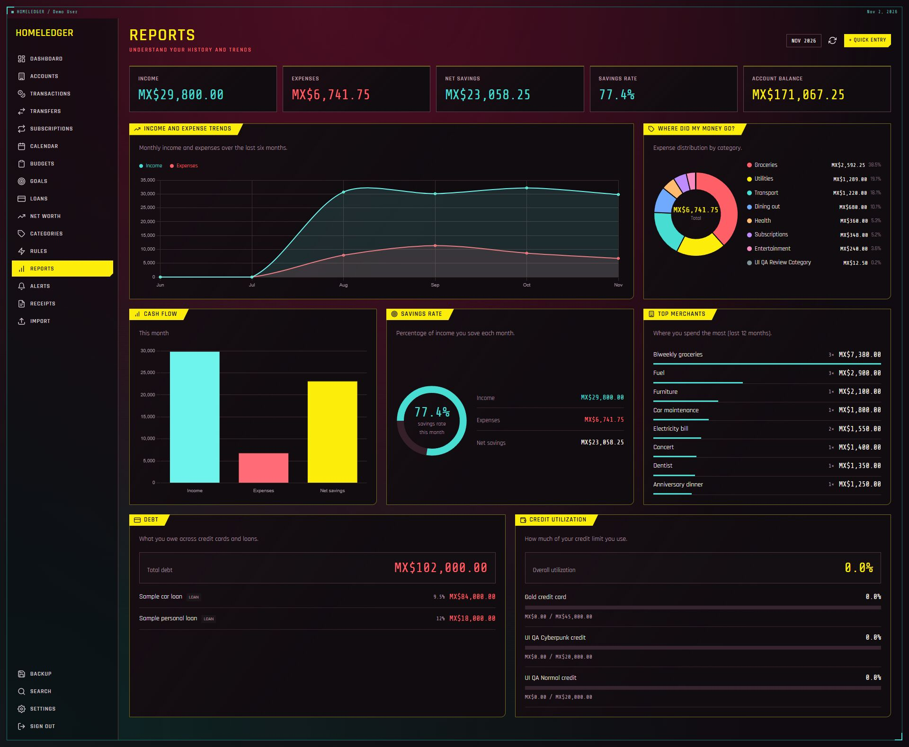

The mobile calendar uses a readable agenda with every event available. The
example below shows one complete day.

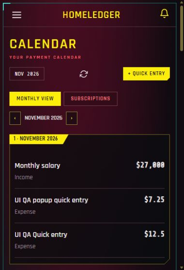
